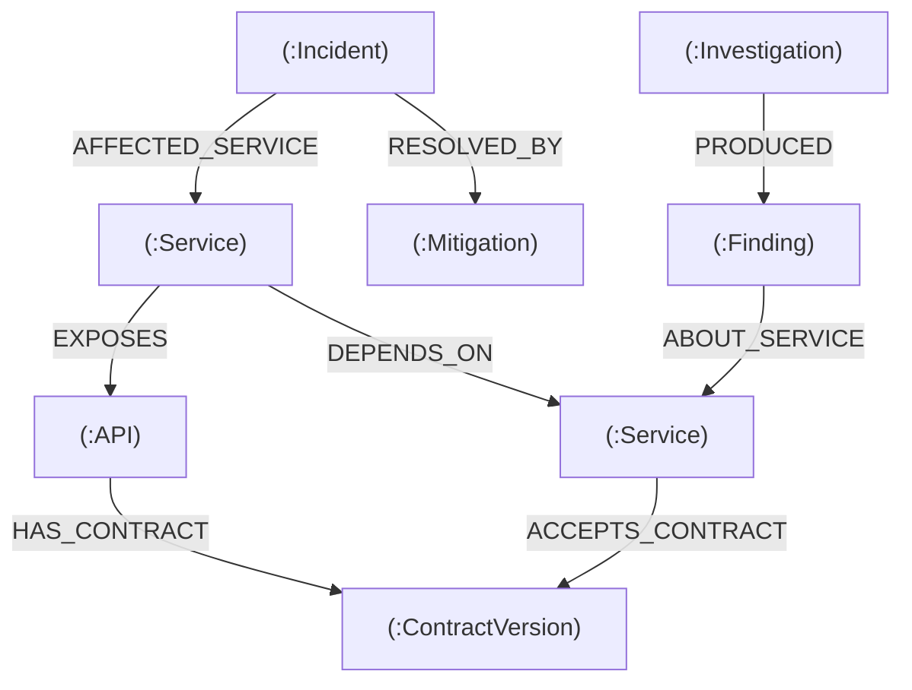

# RippleGraph — Multi-Agent Change Impact Rehearsal Engine

> **See the ripple before you ship.**  
> An autonomous multi-agent rehearsal engine powered by **FalkorDB** and **Google Gemini** that simulates the blast radius of API contract changes across microservice ecosystems before they reach production.

[](https://falkordb.com)
[](https://fastapi.tiangolo.com)
[](https://reactflow.dev)
[](https://ai.google.dev)
[-8A2BE2)](https://modelcontextprotocol.io)
[](https://github.com/bhavesh-018/RippleGraph)

---

## 🏆 Graph Hacks Submission Details

Built for **WeMakeDevs x FalkorDB Graph Hacks (2026)**.
- **Track 01:** Agents That Act on Connected Data
- **Track 02:** Agent Memory and Coordination

### 🎥 Live Video Demo
👉 **[Watch the Complete Demo Video on YouTube](https://youtu.be/YOUR_VIDEO_LINK)** *(Replace with your link)*  
*No slides. 100% working software demonstration with live Proof Mode toggle and episodic memory diffs.*

**Video Chapters:**
- `00:00` The Blind Agent Problem
- `00:25` Track 1: 4-Stage Multi-Agent Connected Pipeline
- `00:55` Graph Topology & Verifiable Evidence Paths
- `01:30` The Money Shot: Proof Mode (FalkorDB Disconnected vs Connected)
- `02:15` Track 2: Episodic Agent Memory & Temporal Decay ($e^{-0.05\Delta t}$)
- `02:50` Gemini NL-to-Cypher Query Engine
- `03:15` Model Context Protocol (FastMCP) & Mitigation Plan Export

---

## 🚨 The Problem

Modern autonomous coding agents can refactor code, but **LLMs are blind to transitive ripple effects across distributed systems.**
When `auth-service` alters a JWT claim (`sub` $\rightarrow$ `subject_id`), direct consumers might be warned — but `checkout-gateway`, which depends on `order-service`, which depends on `payment-service`, which depends on `auth-service`, silently breaks 3 hops downstream.

- **Flat LLM Context**: Fails on multi-hop cascades and hallucinates contract safety.
- **Relational Joins**: Recursive $n$-hop dependency queries are slow and unscalable.
- **Vector Embeddings**: Cannot compute structural topology, deterministic claim matching, or cyclic dependencies.

---

## 💡 The Solution: FalkorDB as the Agent Context Layer

RippleGraph puts the microservice topology, API contracts, incident history, and agent findings into **FalkorDB**. 
Rather than guessing, a coordinated team of 4 specialized agents navigates graph edges via sub-millisecond Cypher queries to compute blast radius, verify contracts, and learn from past outages.

```
┌────────────────────────────────────────────────────────────────────────────────────────┐
│                        RippleGraph Multi-Agent Architecture                            │
└───────────────────────────────────────────┬────────────────────────────────────────────┘
                                            │
       ┌────────────────────────────────────┼────────────────────────────────────┐
       ▼                                    ▼                                    ▼
┌───────────────┐                  ┌─────────────────┐                  ┌────────────────┐
│ Stage 1 Agent │                  │  Stage 2 Agent  │                  │ Stage 3 Agent  │
│   Topology    │ ── Subgraph ──►  │  Risk & Memory  │ ── Findings ──►  │   Governance   │
│ (Hop Traversal│                  │ (Claims + Decay)│                  │(Tier SLAs/Ops) │
└───────────────┘                  └─────────────────┘                  └───────┬────────┘
                                                                                │
                                                                                ▼
┌───────────────────────────────────────────────────────────────────────┌────────────────┐
│                       FalkorDB Graph Layer                            │ Stage 4 Agent  │
│  (:Service) ──[:DEPENDS_ON]──► (:Service) ──[:ACCEPTS]──► (:Contract) │   Synthesis    │
│  (:Investigation) ──[:RECALLS]──► (:Incident)                         │(Remediation)   │
└───────────────────────────────────────────────────────────────────────└────────────────┘
```

---

## 🗺️ Graph Data Model

The graph acts as the single source of truth for both structural infrastructure and dynamic agent memory.

### Node Types
| Label | Description | Key Properties |
| :--- | :--- | :--- |
| `:Service` | Microservice instance in the ecosystem | `id`, `name`, `tier` (platform/core/supporting), `owner_team`, `runtime`, `port` |
| `:API` | Concrete API surface exposed by a service | `id`, `name`, `protocol` (REST/gRPC), `path`, `service_id` |
| `:ContractVersion` | Versioned schema and expected payload claims | `id`, `version`, `status` (active/proposed), `breaking_change`, `claims` |
| `:Incident` | Real historical post-mortem outage record | `id`, `title`, `severity`, `root_cause`, `occurred_at` |
| `:Mitigation` | Verified architectural recipe to prevent recurrence | `id`, `title`, `description`, `validation_method` |
| `:Investigation` | Episodic memory record of an agent rehearsal | `id`, `change_id`, `created_at`, `status`, `rehearsal_score` |
| `:Finding` | Concrete risk assessment with mathematical proof | `id`, `service_id`, `status` (incompatible/risk), `confidence`, `hop_depth` |

### Relationships (Edges)
- `(:Service)-[:DEPENDS_ON {protocol, latency_ms}]->(:Service)`: Multi-hop upstream/downstream dependency.
- `(:Service)-[:EXPOSES]->(:API)`: Service to API mapping.
- `(:API)-[:HAS_CONTRACT]->(:ContractVersion)`: Contract versioning.
- `(:Service)-[:ACCEPTS_CONTRACT]->(:ContractVersion)`: Consumer compatibility contract.
- `(:Incident)-[:AFFECTED_SERVICE]->(:Service)`: Historical outage footprint.
- `(:Incident)-[:RESOLVED_BY]->(:Mitigation)`: Post-mortem recovery procedure.
- `(:Investigation)-[:PRODUCED]->(:Finding)`: Dynamic agent memory trail.
- `(:Finding)-[:ABOUT_SERVICE]->(:Service)`: Agent finding target.



---

## 🛡️ Show the Graph Doing the Work (Hackathon Rule 3 Proof)

Hackathon Rule 3 states: *"The graph has to do real work. If the product still works once FalkorDB is taken out, the graph is decoration."*

RippleGraph includes a live **Proof Mode Toggle** in the navigation bar. When toggled, FalkorDB is disconnected and the LLM agent runs naked:

| Capability | With FalkorDB (Connected) | Without FalkorDB (Proof Mode) | Impact |
| :--- | :--- | :--- | :--- |
| **Transitive Blast Radius** | **7 services discovered** (across 3 hops) | **0 services discovered** | LLM is completely blind to downstream outages. |
| **Contract Claim Diffing** | Deterministic Cypher match on schema tokens | Hallucinated safety ("No breaking changes") | Catastrophic production outage. |
| **Historical Memory Recall** | Recalls INC-101 in **< 1.2ms** via index | 0 incidents recalled | Repeated mistakes across teams. |
| **Confidence Scoring** | Mathematical decay: $e^{-\lambda \Delta t}$ | Static guess | Loss of temporal calibration. |
| **Execution Latency** | Sub-millisecond `GRAPH.RO_QUERY` | N/A (Failed discovery) | Instant pre-flight CI/CD gate. |

---

## 🧠 Track 02: Episodic Memory & Temporal Decay

RippleGraph does not store conversational transcripts in flat files. Past rehearsals are committed directly into FalkorDB as `(:Investigation)` and `(:Finding)` nodes.

When an agent runs a new rehearsal:
1. **Memory Recall**: Cypher retrieves historical findings on intersecting services:
   ```cypher
   MATCH (inv:Investigation)-[:PRODUCED]->(f:Finding)-[:ABOUT_SERVICE]->(s:Service)
   WHERE s.id IN $service_ids
   RETURN f, inv.created_at ORDER BY inv.created_at DESC
   ```
2. **Temporal Decay Curve**: Confidence decays exponentially over time using:
   $$\text{Decay Factor} = e^{-\lambda \Delta t} \quad (\lambda = 0.05, \Delta t = \text{days old})$$
3. **Reaffirmation vs Staleness**:
   - If an active risk persists in the new rehearsal, confidence is boosted (`reaffirmed = True`).
   - If a prior incompatibility is resolved by a newer schema, it is flagged as `is_stale = True` with audit proof.
4. **Visual Memory Scoreboard**: A dedicated 2×2 metric comparison diffing **Cold Start (Memory OFF)** vs **FalkorDB (Memory ON)**.

---

## ⚡ Model Context Protocol (FastMCP)

RippleGraph exposes a native FastMCP server (`backend/mcp_server.py`), allowing external developer AI tools (Cursor, Claude Desktop) to invoke graph tools directly during code generation:

- `rehearse_change(change_id, memory_enabled)`: Runs the 4-stage pipeline before committing a PR.
- `get_blast_radius(service_id, max_depth)`: Returns the multi-hop dependency tree.
- `check_contract_compatibility(service_id, contract_id)`: Validates claim sets.
- `nl_graph_query(question)`: Generates and executes safe read-only Cypher queries via Google Gemini.

---

## 🚀 Getting Started

### Local Setup (Quickest)

1. **Clone the repository**:
   ```bash
   git clone https://github.com/bhavesh-018/RippleGraph.git
   cd RippleGraph
   ```

2. **Start FalkorDB in Docker**:
   ```bash
   docker run -d --name ripplegraph-falkordb -p 6379:6379 falkordb/falkordb:latest
   ```

3. **Start Backend**:
   ```bash
   cd backend
   python -m venv venv
   source venv/bin/activate  # Or `venv\Scripts\activate` on Windows
   pip install -r requirements.txt
   python -m graph.seed      # Seeds the 10-service topology into FalkorDB
   uvicorn main:app --reload --port 8000
   ```

4. **Start Frontend**:
   ```bash
   cd ../frontend
   npm install
   npm run dev
   ```
   Open **`http://localhost:5173`** in your browser.

5. **Run Test Suite**:
   ```bash
   cd ../backend
   pytest tests/  # 212 passed in ~6s
   ```

---

## 📜 AI Usage Disclosure (Rule 11)

In compliance with **Hackathon Rule 11**:
- **Human Authorship**: The team designed the core product architecture, multi-agent coordination protocol, graph schema, Cypher queries, Proof Mode concept, and UI interactions.
- **AI Tools Used**: Google Gemini (`gemini-flash-latest`) powers the runtime natural-language-to-Cypher generator and Stage 4 remediation synthesis. Antigravity IDE (Gemini 2.5 Flash / Claude Sonnet) was used for test writing, code generation assistance, and styling refinements.
- **Verification**: All 212 backend unit and integration tests, Cypher queries, and UI components were reviewed and validated by the team.

---

## 📄 License
MIT License. Built with ❤️ for **FalkorDB Graph Hacks 2026**.
